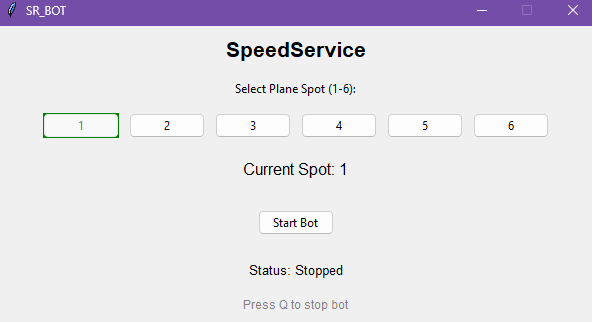
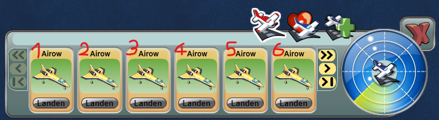

# SR_BOT (SpeedService)

A Python-based automation tool to help manage planes quickly and efficiently.

## ⚠️ Important Requirements

Before running the bot, please ensure your setup matches the following strict requirements. Because the bot relies on image and coordinate detection, failing to follow these will break the bot:

* **Resolution:** Your display resolution MUST be set to **1440p**. (Support for more resolutions is planned for future updates).
* **Zoom Level:** Do not zoom in or out of the airport. Keep the camera at the default zoom level.
* **QuickService (QS):** QuickService must be **enabled** in-game for the bot to work.

## 🚀 How to Use

1. **Install Dependencies:** Make sure you have the required Python libraries installed (e.g., `pip install -r requirements.txt`).
2. **Launch the Bot:** Run the Python script to open the SpeedService GUI.
3. **Select Your Spot:** Select the plane spot (1 through 6) in the bot menu that corresponds to the slot you want to automate.

**GUI Reference:**

**In-Game Spot Reference:**

4. **Set Your Game Mode:** The bot does not automatically toggle between tasks. You must **manually** switch the game UI depending on whether you want to:
   * Send out your own planes
   * Receive planes from buddies

5. **Start:** Click **Start Bot** in the GUI.
6. **Stop:** Whenever you need to halt the automation, simply press the **`Q`** key on your keyboard.